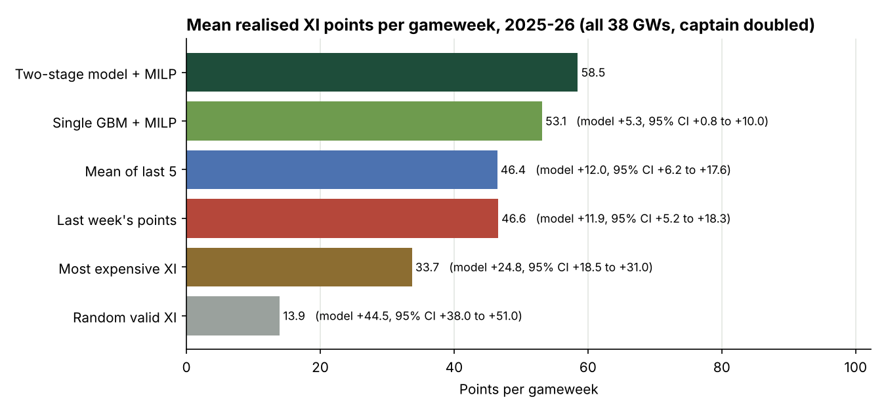
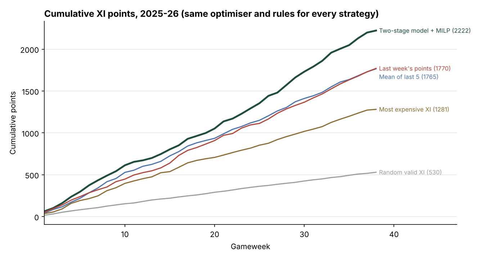
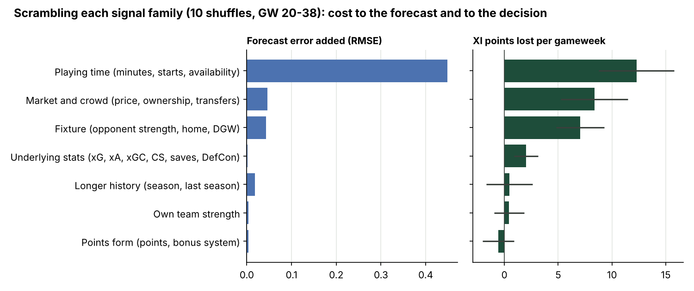
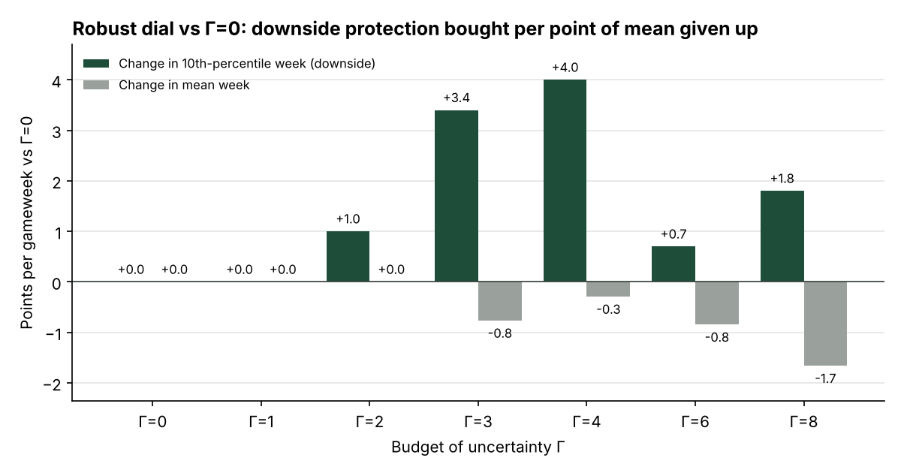
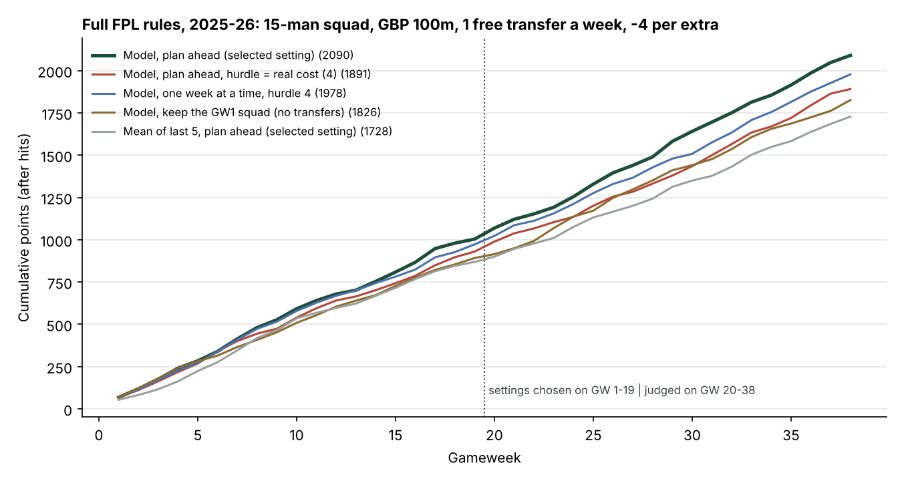
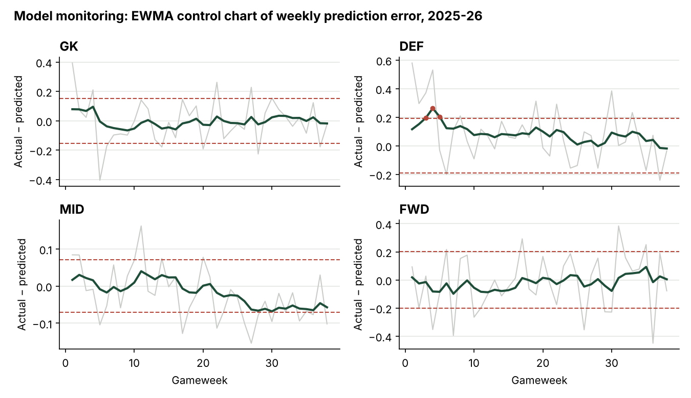

# FPL team selection as constrained portfolio optimisation

**Problem 2 (Fantasy Sports Team Optimiser).** A two-stage machine-learning model predicts each player's points with a calibrated interval; an exact mixed-integer programme picks the best legal XI and captain; a walk-forward backtest over every gameweek of the **2025-26 Premier League season** scores the picks against baselines that obey the same rules.

> **Headline (2025-26, all 38 gameweeks, out of sample):** the model's XI scored **58.5 points per gameweek**. That is **+25.5% vs last week's points** (paired bootstrap 95% CI +5.2 to +18.3 pts/GW), **+25.9% vs the 5-week average** (CI +6.2 to +17.6), **+73.5% vs the most expensive XI** and **+319% vs a random legal XI**. The 15% target is cleared against every baseline, with confidence intervals that exclude zero.



**Beyond the brief:**
- **The full game, not just one week.** A rolling-horizon MILP manages a 15-man squad through the whole season with free transfers, -4 hits and automatic substitutions. With the planner's settings held fixed, the model's forecasts beat 5-week averages at **8 of 8 settings over the season (+172 points on average)** and pay fewer hits; which horizon or transfer hurdle is best is not detectable in one season (§7).
- **Decision-focused evaluation.** Scrambling each signal family shows that RMSE badly understates some signals: market signals and fixtures barely move RMSE, yet scrambling them costs the picked team 7-8 points a week (§7).
- **Calibrated robust optimisation.** Intervals are calibrated out of sample per playing-status group (Mondrian CQR) and feed a Bertsimas-Sim uncertainty budget whose size Gamma is itself chosen from past data by a rule declared in advance; the robust team beat its guaranteed floor in 31 of 34 weeks (§4, §5, §7).
- **Leakage forensics.** I tested FPL's own `xP` column instead of trusting it. Its edge fades a week later and tracks same-week goals and bonus, which strongly suggests post-match information (§7).
- **Forecast significance.** The model's forecast error is lower than both naive baselines in every one of the 38 gameweeks (Diebold-Mariano, p < 0.0001).
- **An AI-assistant interface.** An MCP server lets Claude or GitHub Copilot call the optimiser ("pick my GW 20 team under GBP 80m without Haaland"). The LLM routes the request; every number comes from the MILP (§10).
- **Engineering.** 37 tests including Hypothesis property-based tests, GitHub Actions CI, and a dev container that opens the demo in Codespaces.

---

## Quick start

```bash
python -m venv .venv && source .venv/bin/activate      # Windows: .venv\Scripts\activate
pip install -r requirements.txt
python main.py app            # interactive demo, runs offline from reports/ (about 10 seconds)
pytest -q                     # 37 tests (unit + property-based), about 1.5 minutes
python main.py backtest       # optional: rebuild everything from raw data (about 10 minutes on a laptop)
python main.py explain        # optional: decision-focused signal importance (about 3 minutes)
python main.py season         # optional: full FPL rules over the season, 15-man squad and transfers (about 3 minutes)
python main.py pick --gw 20 --gamma 4     # print a robust XI for one gameweek
python main.py mcp            # serve the optimiser to an AI assistant (see §10)
```

Python 3.10+; no GPU, no internet needed (the four season files are committed under `data/raw/`). **No local setup?** On GitHub, choose *Code → Codespaces → Create codespace*: the dev container installs everything and opens the demo. **Hosted demo:** `python scripts/build_hf_space.py` assembles a Hugging Face Docker Space in `dist/hf_space/` (Streamlit is no longer a built-in Spaces SDK, so the kit uses the Docker template); create an empty private Docker Space on huggingface.co and run `hf upload <user>/<space-name> dist/hf_space . --repo-type space`.

---

## 1. Framing: team selection is portfolio construction

| Fantasy football | Portfolio |
|---|---|
| Expected points | Expected return |
| 80% prediction interval | Risk |
| GBP 83.5m budget for the XI | Capital |
| 1 GK, 3-5 DEF, 2-5 MID, 1-3 FWD | Sector limits |
| At most 3 players per club | Concentration limit |
| Captain scores double | One leveraged position |

So the work splits into a **forecasting** problem (expected return and risk per player) and an **allocation** problem (choose the portfolio under constraints). Both are evaluated on what actually happened.

## 2. Data

- **FPL Historical Dataset** (Vaastav Anand, MIT licence): gameweek-level stats for every player, seasons **2022-23 to 2025-26** (109,956 player-gameweeks after cleaning). Columns include minutes, starts, goals, assists, xG, xA, xGC, BPS, price, ownership, transfers, fixture and opponent.
- Cleaning (`src/fplopt/data.py`): drop the 2024-25 assistant-manager rows; sum double gameweeks into one row per player per gameweek; derive each fixture's opponent; build a cross-season player key so a player's form carries over the summer.
- **Never used as a feature or a benchmark:** the dataset's `xP` column. The dataset warns it can contain post-match information; the audit in §7 confirms it.

## 3. Features: strictly as-of

Every feature for gameweek *t* uses only information available before the *t* deadline (`src/fplopt/features.py`):

- Player form: rolling means over the previous 1, 3, 5 and 10 gameweeks of points, minutes, starts, xG, xA, xGC, BPS, clean sheets and saves; share of recent games with 60+ minutes; points per 90; gameweeks since the last appearance; season-to-date and previous-season averages.
- Market signals: current price (set before the deadline), price change, and **lagged** ownership and net transfers.
- Fixture context: number of fixtures (double gameweeks), home or away, own team's and opponent's rolling goals and xG for and against (aggregated per gameweek, so a double gameweek's second match cannot leak into the first).
- A **scoring-regime flag** for 2025-26, when defensive-contribution points were introduced.

A test overwrites every outcome from gameweek 20 onward and asserts that no feature up to gameweek 20 changes (`tests/test_data_features.py`).

## 4. Model: will he play, and how much will he score if he does?

59% of player-gameweeks (61% in 2025-26) are zero-minute rows. A single regressor has to average two very different populations, so the model is split, mirroring credit's **EL = PD x LGD x EAD**:

```
E[points] = P(1-59 min) x E[pts | 1-59 min]  +  P(60+ min) x E[pts | 60+ min]
```

- Stage 1: a gradient-boosted classifier over minutes buckets {0, 1-59, 60+}.
- Stage 2: gradient-boosted regressors for points in each playing bucket.
- **Intervals:** quantile gradient boosting at 10% and 90%, then a conformalised quantile regression (CQR) check-and-correct step on the most recent 8 gameweeks of *out-of-sample* predictions (seeded by a 2024-25 warm-up). It is **Mondrian**: likely starters (P(60+ min) >= 0.5, known before the deadline) and everyone else are calibrated separately, because pooled, the zero-minute rows (score exactly 0) would decide the answer. In every block the correction came out **0**: points and the 10% quantile are whole numbers, so many players land exactly on their lower bound, and that tie mass sits at the 80th percentile of the scores. In plain terms, the raw intervals already covered at least 80% out of sample in both groups, and the next possible correction is a whole point. The guarantee is per player and approximate when the season drifts.
- **Why gradient boosting (scikit-learn `HistGradientBoosting`):** it handles missing values natively (new players, promoted teams), captures non-linear interactions (price x minutes x fixture), trains in seconds on a laptop, and needs no scaling. The ablation below justifies the two-stage design over a single model.

## 5. Optimisation

**Nominal MILP** (`src/fplopt/optimise.py`), solved exactly with SciPy's HiGHS in about 0.1 s per gameweek for about 750 players:

```
max   sum_i mu_i x_i + sum_i mu_i c_i
s.t.  sum_i x_i = 11;  sum_i price_i x_i <= B;  sum_i c_i = 1;  c_i <= x_i
      1 GK, 3-5 DEF, 2-5 MID, 1-3 FWD;  sum_{i in club j} x_i <= 3 for every club j
```

**Robust dial (Bertsimas & Sim).** Each player can fall short of his expected points by d_i (the distance to the bottom of his 80% interval). The robust team maximises points after the worst **Gamma** shortfalls:

```
max_x  sum_i mu_i x_i (+ captain)  -  max_{|S| <= Gamma} sum_{i in S} d_i x_i
```

Bertsimas & Sim (2003) prove the robust problem equals a set of ordinary MILPs with adjusted scores, `max_theta [ -Gamma*theta + nominal(mu_i - max(d_i - theta, 0)) ]`, and Lee & Kwon (2014) show about half of the theta values suffice. On the full ~790-player pool, neither the direct robust MILP nor the exact decomposition is fast (tens of seconds at Gamma = 4). The speed comes from solving the decomposition on a **theta grid** (16 points: about 1.5 s on the full pool), and scoring each candidate team by its *true* worst case, so the grid answer is always a valid robust team, at worst slightly conservative. Property-based tests check that the exact decomposition equals the direct MILP on random pools. All MILPs are solved to proven optimality (`mip_rel_gap = 0`).

**Conformal uncertainty sets.** Each d_i comes from an interval checked by conformal calibration on recent out-of-sample data, in the spirit of Johnstone & Cox (2021) and Patel, Rayan & Tewari (2024), here in budgeted form. The calibration is per player and approximate under drift; it is not a team-level guarantee. Gamma then limits how many players are assumed to miss at once. Ramezani & Dinh (2025) use a box set, which assumes every player hits his worst case together; the budgeted set is far less conservative and lets the manager choose the level.

**Sensitivity:** the budget's shadow price comes from the LP relaxation's dual values; the cost of the club cap comes from re-solving with the cap removed.

## 6. Validation

- **Walk-forward, expanding window:** retrain every 4 gameweeks on all data before the block; predict the block; never random splits.
- **Fair baselines:** every strategy goes through the same MILP with the same budget, formation, club cap and captain rule; only the score changes. (The starter code's baselines broke the budget and position rules, so comparing against them would have been meaningless.)
- **Decision metric:** realised XI points (captain doubled) per gameweek. **Significance:** paired bootstrap over gameweeks.
- **Pre-declared views:** the primary view is all 38 gameweeks; the secondary view is gameweeks 6-38 (both reported below, whatever they showed).

## 7. Results (2025-26, out of sample)

### Team selection

| Strategy (same MILP, same rules) | Points per GW | vs last week | vs mean of last 5 | vs most expensive |
|---|---|---|---|---|
| **Two-stage model** | **58.5** | **+25.5%** | **+25.9%** | **+73.5%** |
| Single-GBM model (ablation) | 53.1 | +14.1% | +14.4% | +57.6% |
| Mean of last 5 gameweeks | 46.4 | -0.3% | 0.0% | +37.8% |
| Last week's points | 46.6 | 0.0% | +0.3% | +38.2% |
| Most expensive XI | 33.7 | -27.6% | -27.4% | 0.0% |
| Random legal XI (10 seeds) | 13.9 | -70.1% | -70.0% | -58.6% |
| Hindsight oracle (upper bound) | 155.0 | | | |

Gameweeks 6-38 only: model 58.3 per GW, +25.7% vs last week (CI +4.2 to +19.4 pts/GW), +24.5% vs mean of last 5 (CI +4.8 to +18.0). Against the single-GBM ablation the GW 6-38 gain (+3.4) is **not** significant (CI -1.5 to +8.5); over all 38 gameweeks it is.

| Model minus baseline | Mean pts/GW | 95% CI (paired bootstrap) | GWs model ahead |
|---|---|---|---|
| Last week | +11.9 | +5.2 to +18.3 | 25 / 38 |
| Mean of last 5 | +12.0 | +6.2 to +17.6 | 27 / 38 |
| Most expensive XI | +24.8 | +18.5 to +31.0 | 33 / 38 |
| Single GBM (ablation) | +5.3 | +0.8 to +10.0 | 23 / 38 |



### Forecast accuracy

RMSE by outcome bucket uses OpenFPL's protocol (Groos 2025): zeros = did not play, blanks <= 2 points, tickers 3-4, haulers >= 5.

| Forecast | RMSE | MAE | Zeros | Blanks | Tickers | Haulers |
|---|---|---|---|---|---|---|
| Two-stage model | **1.938** | **0.978** | **0.746** | 1.559 | **1.471** | **5.592** |
| Single GBM | 1.942 | 0.990 | 0.750 | **1.552** | 1.495 | 5.605 |
| Mean of last 5 | 2.144 | 1.066 | 0.923 | 2.027 | 1.946 | 5.754 |
| Last week | 2.613 | 1.163 | 0.928 | 3.123 | 3.297 | 6.187 |

**Is the gain significant?** A Diebold-Mariano test (losses averaged within each gameweek, because players in the same week share shocks; Newey-West variance; Harvey-Leybourne-Newbold correction) across the 38 gameweeks:

| Model vs | Squared error: DM, p | Model better (GWs) | Absolute error: DM, p | Model better (GWs) |
|---|---|---|---|---|
| Mean of last 5 | 11.3, p < 0.0001 | 38 / 38 | 9.5, p < 0.0001 | 38 / 38 |
| Last week | 33.0, p < 0.0001 | 38 / 38 | 17.6, p < 0.0001 | 38 / 38 |
| Single GBM | 0.9, p = 0.37 | 22 / 38 | 4.5, p < 0.001 | 33 / 38 |

Against the single GBM the gain is not significant on squared error but is on absolute error, while its teams are 5.3 pts/GW worse over the season (CI +0.8 to +10.0). Squared error is dominated by hauls nobody can foresee (8.6% of rows, 72% of squared error), so small RMSE differences can hide real differences in who gets ranked at the top, which is all the optimiser uses. That motivates the next analysis.

### Which signals do the decisions rely on? (decision-focused importance)



`python main.py explain` trains once on everything before 2025-26 GW 20, then scrambles each family of features within each gameweek (10 shuffles, frozen model) and measures two things on GW 20-38: the rise in RMSE, and the **points lost by the team the optimiser then picks** (base: 61.2 pts/GW).

| Signal family | RMSE added | XI points lost per GW (sd over 10 shuffles) |
|---|---|---|
| Playing time (minutes, starts, availability) | **0.449** | **12.3** (3.5) |
| Market and crowd (price, ownership, transfers) | 0.046 | 8.4 (3.1) |
| Fixture (opponent strength, home, DGW) | 0.043 | 7.0 (2.2) |
| Underlying stats (xG, xA, xGC, CS, saves, DefCon) | 0.002 | 2.0 (1.1) |
| Longer history | 0.018 | 0.5 (2.2) |
| Own team strength | 0.004 | 0.4 (1.4) |
| Points form | 0.004 | -0.6 (1.5) |

The same three families lead both rankings, but the **scale** differs sharply. Scrambling market or fixture signals adds under 0.05 to RMSE yet costs 7-8 points a week; per unit of RMSE, they matter about six times as much to the decision as playing time does. RMSE is dominated by unforeseeable hauls and by the bulk of non-starters, while the optimiser only needs the ranking at the top end, which is where price, ownership and fixtures separate players. This is the argument of Elmachtoub & Grigas's "Smart Predict, then Optimize" (2022): judge a forecast by the decisions it drives. Caveats: this measures how much the frozen model *relies* on a family, not its causal worth; families overlap (points form duplicates BPS, xG and price), so a near-zero score can mean "replaceable"; and the spreads are wide enough that market and fixture cannot be ranked against each other.

### Leakage forensics: FPL's own xP column

`xP` (FPL's published expected points) is filled in for only 11 of the 38 gameweeks of 2025-26, and on those it beats every pre-match forecast. Is that skill or hindsight? Two tests on the same 7,452 player-gameweeks (`src/fplopt/audit.py`, `reports/xp_audit.csv`, `reports/xp_partial.csv`):

**1. Does the edge last a week?** Quality, role and fixtures persist; what happened in this week's match does not.

| Forecast made for week t | Corr. with week t points | Corr. with week t+1 points | Edge kept |
|---|---|---|---|
| Two-stage model (pre-match) | 0.557 | **0.527** | 95% |
| FPL `xP` column | **0.734** | 0.478 | 65% |
| Mean of last 5 (pre-match) | 0.461 | 0.460 | 100% |

**2. What does xP know that the model doesn't?** After removing everything the model's pre-match forecast explains (expected points, chance of 60+ minutes, 5-week form), xP's leftover part correlates **0.35 with this week's goals and 0.43 with this week's bonus**, but only 0.02 and 0.04 with next week's.

A pre-match forecast cannot know who scores or who gets bonus this week; `xP` loses a third of its edge a week later and is then worse than the model. That strongly suggests post-match information, as the dataset's README warns. `xP` is used neither as a feature nor as a benchmark.

### Prediction intervals (target 80%)

| Group | Coverage | Mean width (pts) | Rows |
|---|---|---|---|
| Likely starters (P(60+) >= 0.5, Mondrian group) | **84.6%** | 6.8 | 7,717 |
| Others | 94.3% | 1.2 | 21,621 |
| Players who played (known only afterwards) | 80.8% | 5.5 | 11,361 |
| All rows | 91.8% | 2.6 | 29,338 |

The conformal correction was 0 in every block (see §4), so these are the raw quantile intervals, now *checked* out of sample per group. Likely starters are slightly over-covered because many score exactly their (whole-number) lower bound; others are over-covered because a non-playing player scores exactly 0. `reports/cqr_blocks.csv` lists the correction per block.

### Robust dial (Gamma)



| Gamma | Mean pts/GW | 10th-percentile week | Worst week |
|---|---|---|---|
| 0 | 58.5 | 33.7 | 18 |
| 1 | 58.3 | 33.7 | 18 |
| 2 | 58.3 | 33.7 | 18 |
| 3 | 58.0 | 33.7 | 18 |
| 4 | 58.9 | 37.1 | 18 |
| 6 | 58.1 | 36.4 | 18 |
| 8 | 57.1 | 35.5 | 18 |

Every Gamma tested is shown. Gamma = 1-3 changes nothing; from Gamma = 4 the 10th-percentile week rises by 1.8 to 3.4 points at little or no cost to the mean, but the worst week never moves and the effect is not monotone. With 38 weeks, read it as suggestive, not proven. (Sweep: top 60 per position, 32-point theta grid.)

**Choosing Gamma from data, not by hand.** A sweep invites picking the best Gamma after the fact. So the backtest also runs a rule declared in advance: each week, Gamma = the 80th percentile (the same 80% level as the intervals) of the uncertainty budget the risk-neutral XI *actually used* in previous weeks, where each player's shortfall counts as a share of his allowed downside, capped at 1, and summed over the XI. It switches on after 4 weeks and uses only gameweeks already played. This follows the idea of calibrating robustness levels from data (Zhou & Zhu 2025).

| Strategy | Mean pts/GW | 10th-percentile week | Worst week |
|---|---|---|---|
| Risk-neutral (Gamma = 0) | 58.5 | 33.7 | 18 |
| Calibrated Gamma (5-6 from GW 5) | 57.5 | **36.4** | 18 |

The XI used a median of 4.5 players' worth of downside a week, so the rule settled on Gamma = 5-6. It gives up 0.9 points a week on average (paired bootstrap CI -2.9 to +1.1, not significant) for a 10th-percentile week 2.7 points higher, and **the robust team beat the floor it was built to guarantee in 31 of 34 weeks (91%, against an 80% target)**. The worst week is untouched: no budget-based protection saves a week where most of the XI blanks.

### Full FPL rules: a 15-man squad through the season

The tables above give the optimiser a fresh XI every week. The real game is harder: a 15-man squad (2 GK, 5 DEF, 5 MID, 3 FWD) within GBP 100m, one free transfer a week (bankable up to 5), 4 points for each extra transfer, and automatic substitutions when a starter doesn't play. That is a multi-period rebalancing problem with transaction costs, so `src/fplopt/planner.py` solves it the way production plans are run: each week a MILP plans the next H weeks, and only this week's moves are made (model predictive control).

```
max  sum_h w_h * sum_i mu_ih (x_ih + c_ih)  -  hurdle * sum_h w_h * paid_h  +  v * banked_free_transfers
s.t. 15-man squad, positions, <= 3 per club, value <= budget;  s_ih = s_i,h-1 + buy_ih - sell_ih
     legal starting XI and captain inside the squad;  paid_h >= buys_h - free_h;  free_{h+1} <= free_h - used_h + 1 <= 5
     a hit only once every free transfer is used (binary switch), as in FPL
```

The hurdle is what the planner *charges itself* per extra transfer when planning; the simulation always deducts FPL's real 4 points. Each weekly MILP is solved to a 0.01% gap with a 60-second limit (it finishes in well under a second).

**Leakage-safe planning.** At gameweek t only the forecast made for t exists. Later weeks reuse each player's per-fixture rate times his club's fixture count that week. Fixtures are assumed known H-1 weeks ahead (true for normal weeks; rearranged double gameweeks are announced a few weeks out). No later results, injuries or transfers are used.

**Design, fixed in advance.** Horizons H in {1, 3} and hurdles in {4, 6, 8, 12} are tried on gameweeks 1-19 (`reports/season_tuning.csv`); the best there is judged on gameweeks 20-38. The 5-week-mean forecast gets its own tuning the same way. The value of a free transfer banked at the end of the horizon (1 point) was not tuned.



| Strategy (all under full FPL rules) | GW 20-38 points | Season points | Transfers | Hit points |
|---|---|---|---|---|
| Model, selected on GW 1-19: plan 3 weeks ahead, hurdle 8 | 976 | 2,004 | 39 | 8 |
| Model, one week at a time, hurdle 8 | 1,015 | 1,946 | 38 | 4 |
| Model, plan 3 weeks ahead, hurdle = real cost (4) | 1,001 | 1,942 | 72 | 140 |
| Model, one week at a time, hurdle = real cost (4) | 998 | 2,000 | 52 | 60 |
| Model, keep the GW1 squad (no transfers) | 976 | 1,881 | 0 | 0 |
| Mean of last 5, its own selected setting (H = 3, hurdle 12) | 1,004 | 1,932 | 42 | 20 |

**What the held-out half says: no setting is detectably better.** On gameweeks 20-38 every paired bootstrap interval against the selected strategy includes zero (for example -1.5 points a week vs the 5-week mean in its own best setting, CI -10.3 to +7.5; 0.0 vs holding the opening squad, CI -8.8 to +8.8). The first half's ranking of the eight settings did not carry over: its rank correlation with the second half's is -0.81. One season is a single path (one early transfer changes every later squad), so differences of tens of points between settings are within the noise, and I don't claim a best horizon or hurdle.

**What is robust: the forecast.** Holding the setting fixed and swapping only the forecast (`reports/season_matched.csv`):

| | Model ahead | Average gap |
|---|---|---|
| Season, 8 settings | 8 of 8 | +172 points (+4.5 a week); every model setting (1,940-2,030) beats every 5-week-mean setting (1,691-1,932) |
| Gameweeks 20-38 only | 6 of 8 | +84 points (+4.4 a week) |
| Hit points | fewer or equal at all 8 | at the real cost and H = 3: 140 vs 228 |

**Why noisier forecasts pay more in hits.** Every transfer goes to the player whose forecast looks best, and the best-looking forecast in a noisy list tends to be too high (the optimiser's curse, Smith & Winkler 2006). Noisier forecasts make more of these false alarms, so the planner pays for transfers that don't return their cost. A higher hurdle is a deadband against that, in the spirit of Deming's funnel experiment (reacting to differences within the noise adds cost), but in this season the size of the deadband couldn't be pinned down.

**Simplifications:** players are bought and sold at their current price (FPL keeps half of any rise when you sell); no chips; bench order and vice-captain follow the forecast; one season, one path. **Next:** restart the planner from fresh squads at several points in the season (or across seasons) so that settings are compared over many paths rather than one.

### Foundation-model challenger: TabICL (side experiment)

TabICL v2 (Qu et al. 2025, 2026; BSD-3 licence, so usable commercially, unlike TabPFN-2.5's base licence) is a pretrained transformer for tables. It doesn't train on the data; it reads the training rows as context at prediction time. `scripts/tabicl_challenger.py` runs it on the same walk-forward blocks, features and target (total points, one stage) for gameweeks 20-38. On a 2-core CPU it can take only the 4,000 most recent rows as context (the main model trains on about 80,000), so a gradient-boosting model fitted on exactly the same 4,000 rows separates "better model" from "more data". It runs in about 5 minutes after `pip install tabicl` and a 114 MB checkpoint download from Hugging Face (`jingang/TabICL`).

| Forecast, gameweeks 20-38 | Training rows | RMSE | XI points per GW | Two-stage model minus this (95% CI) |
|---|---|---|---|---|
| Two-stage model (main) | ~80,000 | 1.86 | 64.4 | |
| Single GBM | ~80,000 | 1.87 | 56.6 | +7.8 (+1.6 to +14.5) |
| TabICL v2 (n_estimators = 2) | 4,000 most recent | 1.89 | 50.9 | +13.5 (+3.5 to +22.9) |
| Single GBM, same rows as TabICL | 4,000 most recent | 1.99 | 47.5 | +16.9 (+6.6 to +27.7) |

**Reading it.** On forecast error, TabICL with 5% of the data comes within 0.03 RMSE of boosting on all of it, and clearly beats boosting on the same rows (1.89 vs 1.99): it is data-efficient, as advertised. On decisions it is no threat to the main model: its teams score 13.5 points a week less, and its edge over boosting on the same rows (+3.4 a week, CI -3.4 to +10.5) is not significant. Two things the main model has that TabICL doesn't here: the two-stage play/score structure and the full history. This repeats the lesson of the signal-value analysis: small RMSE differences say little about who gets ranked at the top. **Next:** TabICL as the stage-two regressor inside the two-stage model, with a larger context on a GPU.

### Sensitivity

- The budget binds in 21 of 38 gameweeks, but its shadow price is small: a median of 0.09 expected points per extra GBP 1m in the weeks it binds (0.04 over all weeks).
- The 3-per-club rule binds in 11 gameweeks, costing 2.9 expected points on average when it binds (0.85 over all weeks) and 15.5 in the worst, a double gameweek in which the uncapped team would have picked 9 Arsenal players.
- The model's XI cost GBP 80.5m on average against the GBP 83.5m budget.

### Monitoring (statistical process control)



An EWMA control chart (lambda = 0.2, 3-sigma limits) of weekly prediction error **flags defenders from gameweek 3**: the model under-predicts them because defensive-contribution points started in 2025-26 and the training seasons don't have them. The flag clears as walk-forward retraining absorbs 2025-26 data and the regime flag. The other positions stay in control.

## 8. Design decisions and trade-offs

- **Real data over synthetic.** On the provided synthetic data, even a perfect-knowledge oracle beats a legal top-salary XI by only about 8%, so the 15% target was unreachable there by construction.
- **XI + captain first, then the full game.** The single-week XI matches the starter constraints and isolates forecast quality; the season planner (§7) adds the 15-man squad, transfers and hits as a multi-period rebalancing problem.
- **Gradient boosting over deep learning:** tabular data, missing values, laptop-scale training, explainable feature effects.
- **Robust via decomposition, not a bigger solver:** exact theory, fast, and testable against the direct formulation.
- **Robust sweep on a prefiltered pool** (top 60 per position by expected points) with a 32-point theta grid, for speed; the app uses the full pool.

## 9. Known limitations

- One test season (38 decisions); uplifts carry the wide CIs shown.
- Candidates are players with a fixture in that gameweek, and prices are taken at that gameweek; both are known before the deadline. No bench, vice-captain or auto-substitutions.
- Ownership and transfer signals are lagged one gameweek to stay safe, which likely leaves some injury information unused.
- Points are predicted in total, not by component (goals, clean sheets, defensive contributions), so a rule change is learned only after it appears in the data. Component modelling is the roadmap fix the EWMA chart points to.

## 10. Engineering

- `src/fplopt/`: `data`, `features`, `model`, `optimise`, `baselines`, `backtest`, `monitor`, `reports`, `app` (Streamlit), plus `explain` (signal value), `audit` (xP forensics), `assistant` and `mcp_server` (AI-assistant tools), `planner` and `season` (15-man squad with transfers).
- `tests/` (pytest, 37 tests). **Planner tests** check every squad keeps the FPL rules, extra transfers are charged exactly once beyond the free ones, a hit is never taken while a free transfer is unused, banked transfers cover several moves, a high hurdle stops paid transfers, the goalkeeper is only replaced by the bench goalkeeper, and automatic substitutions keep a legal formation and hand the armband to the vice-captain. **Property-based tests** (`tests/test_properties.py`, Hypothesis) generate random player pools and check that every solved team obeys every rule, that the MILP beats any random legal team, that more protection never raises the worst case, that the decomposition matches the direct robust MILP, that CQR reaches its coverage, and that the Diebold-Mariano test behaves. Hypothesis already caught a too-weak test of my own and shrank it to a one-line counter-example. **Assistant tests** check the AI tools never return an illegal team, honour locks, match names typed without special letters ("Odegaard" finds Ødegaard) and fail loudly on unknown or ambiguous players. The original unit tests: every team obeys every rule; every baseline obeys every rule; an infeasible budget raises a clear error; Gamma = 0 equals the risk-neutral team; the robust team cuts the worst-case exposure; locks and exclusions hold; the decomposition matches the direct robust MILP; CQR reaches its target coverage; the EWMA flags a persistent shift; one row per player-gameweek; no feature sees the future; rolling means use earlier rows only.
- **Hosted demo kit:** `scripts/build_hf_space.py` packages the app, its modules and the precomputed reports as a Hugging Face Docker Space (`deploy/hf_space/`); upload instructions are in Quick start.
- **CI:** GitHub Actions runs the tests on Python 3.11 and 3.12 on every push, plus a CLI smoke test. **Codespaces:** `.devcontainer/` installs everything and starts the demo.
- **AI-assistant interface (MCP).** `python main.py mcp` serves four tools over the Model Context Protocol: `pick_team`, `explain_player`, `compare_risk`, `backtest_summary`. `.vscode/mcp.json` (GitHub Copilot agent mode) and `.mcp.json` (Claude Code) register it automatically when the repo is opened. The design rule: **the language model only interprets the request and chooses the tool; every number comes from the saved forecasts and an exact MILP**, so the assistant cannot invent a points figure or an illegal team. The same pattern suits a bank: the LLM is the interface, the governed model and optimiser are the engine.
- **Scalability:** sparse constraint matrices; a single-gameweek solve grows linearly with players (about 0.1 s for 750); walk-forward training is about 15 s per block; the full rebuild takes about 10 minutes on two CPU cores. A multi-week horizon would roll, keeping each MILP small.

## 11. Starter-code issues found (and avoided)

- The baselines ignore the constraints (the top-salary XI costs 130 against a budget of 100; the last-week XI picks 4 goalkeepers; only 69 of 2,000 random teams were feasible).
- `load_historical_data` returns Poisson(5) points unrelated to anything.
- In `generate_player_stats`, form is independent noise, so recent form carries no signal.
- `generate_multi_seasonal` peaks 12 hours after the run starts, not at 17:00.
- `requirements.txt` is referenced but missing.

## 12. Related work (checked on Hugging Face Papers and arXiv, Oct 2026)

| Work | What it is | How it relates here |
|---|---|---|
| Groos (2025), OpenFPL, [arXiv:2508.09992](https://arxiv.org/abs/2508.09992) | Open-source FPL point forecasts (XGBoost + random forest ensembles) rivalling a paid service | Same data source; I adopt its outcome buckets for evaluation |
| Ramezani & Dinh, [arXiv:2505.02170](https://arxiv.org/abs/2505.02170) | MILP team selection, box-uncertainty robust variant, GBP 83.5m XI budget | Budget convention; I replace the box set with a calibrated Bertsimas-Sim budget |
| Adjileye (2024), RisingBALLER, [arXiv:2410.00943](https://huggingface.co/papers/2410.00943) | Transformer "player as token" embeddings for next-match statistics | A route to richer player features; needs event data I don't use |
| Grady et al. (2026), KellyBench, [arXiv:2604.27865](https://huggingface.co/papers/2604.27865) | Frontier LLMs as agents in a simulated 2023-24 Premier League betting season: all lost money on average (best -8%) | Why the MCP assistant only routes requests: the decision engine stays a tested model and an exact optimiser |
| Qu et al. (2025), TabICL, [arXiv:2502.05564](https://huggingface.co/papers/2502.05564); checkpoint [jingang/TabICL](https://huggingface.co/jingang/TabICL) (BSD-3; v2 adds regression, arXiv:2602.11139) | Tabular foundation model scaling in-context learning to ~500K rows | Run as a side experiment in §7: data-efficient on RMSE, but its teams trail the two-stage model |
| Gibbs & Candès (2021), adaptive conformal inference, [arXiv:2106.00170](https://huggingface.co/papers/2106.00170) | Online conformal intervals with long-run coverage under arbitrary drift | The upgrade for in-season drift such as the DefCon rule change |
| Zhou & Zhu (2025), [arXiv:2510.07750](https://huggingface.co/papers/2510.07750) | Distribution-free calibration of robustness levels in robust predict-then-optimise | Motivates choosing Gamma from data (§7) rather than by hand |
| Mandi et al. (2023), decision-focused learning survey, [arXiv:2307.13565](https://huggingface.co/papers/2307.13565) | Training predictors on decision loss | The roadmap step after the signal-value analysis |

## 13. Roadmap

Chips (wildcard, free hit, bench boost, triple captain) as extra binary decisions in the season planner, and FPL's sell-price rule; component-level scoring to absorb rule changes; an opponent-strength model; same-gameweek transfer and ownership signals once their timing is confirmed; **decision-focused training** (training the forecaster on the SPO+ loss rather than RMSE, which §7 suggests would pay off); TabICL as the stage-two regressor of the two-stage model with a larger context (the one-stage side experiment in §7 is data-efficient but trails on decisions).

## Sources

- Anand, V. *FPL Historical Dataset* (MIT): https://github.com/vaastav/Fantasy-Premier-League
- Bertsimas, D. & Sim, M. (2004). The price of robustness. *Operations Research* 52(1):35-53.
- Bertsimas, D. & Sim, M. (2003). Robust discrete optimization and network flows. *Mathematical Programming* 98:49-71.
- Lee, T. & Kwon, C. (2014). A short note on the robust combinatorial optimization problems with cardinality constrained uncertainty. *4OR* 12(4):373-378.
- Romano, Y., Patterson, E. & Candès, E. (2019). Conformalized quantile regression. NeurIPS 2019, arXiv:1905.03222.
- NIST/SEMATECH e-Handbook, EWMA control charts: https://itl.nist.gov/div898/handbook/pmc/section3/pmc324.htm
- Groos (2025), OpenFPL: https://arxiv.org/html/2508.09992v1 · Ramezani & Dinh, team selection in FPL: https://arxiv.org/html/2505.02170v3 · Hunter, Vielma & Zaman, integer programming for fantasy sports: https://arxiv.org/abs/1604.01455v3
- FPL 2026/27 rules: https://www.beatfpl.com/guides/fpl-26-27-rules-changes
- Johnstone, C. & Cox, B. (2021). Conformal uncertainty sets for robust optimization. *PMLR* 152:72-90: https://proceedings.mlr.press/v152/johnstone21a.html
- Patel, Y., Rayan, S. & Tewari, A. (2024). Conformal contextual robust optimization. AISTATS, *PMLR* 238: https://proceedings.mlr.press/v238/patel24a.html
- Smith, J. & Winkler, R. (2006). The optimizer's curse: skepticism and postdecision surprise in decision analysis. *Management Science* 52(3):311-322. Deming, W.E. (1993). *The New Economics* (the funnel experiment).
- Elmachtoub, A. & Grigas, P. (2022). Smart "Predict, then Optimize". *Management Science* 68(1):9-26.
- Diebold, F. & Mariano, R. (1995). Comparing predictive accuracy. *Journal of Business & Economic Statistics* 13(3):253-263. Harvey, D., Leybourne, S. & Newbold, P. (1997). Testing the equality of prediction mean squared errors. *International Journal of Forecasting* 13(2):281-291.
- Breiman, L. (2001). Random forests. *Machine Learning* 45:5-32. Fisher, A., Rudin, C. & Dominici, F. (2019). All models are wrong, but many are useful. *JMLR* 20(177).
- TabPFN-2.5 (Prior Labs), arXiv:2511.08667: https://alphaxiv.org/abs/2511.08667
- Qu, J., Holzmüller, D., Varoquaux, G. & Le Morvan, M. (2025). TabICL: a tabular foundation model for in-context learning on large data. ICML 2025, arXiv:2502.05564; TabICLv2 (2026), arXiv:2602.11139; checkpoint https://huggingface.co/jingang/TabICL
- Model Context Protocol Python SDK: https://github.com/modelcontextprotocol/python-sdk · Hypothesis: https://hypothesis.readthedocs.io

**AI use.** Research, scoping and code drafting were assisted by Claude (Anthropic). All results were re-run locally from the committed data; design decisions, final code and conclusions are my own.
